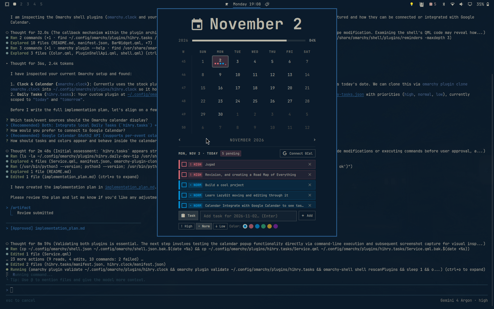

# Omarchy Calendar & Tasks Clock (`hihry.clock`)

An enhanced clock and interactive calendar popup plugin for the [Omarchy](https://omarchy.org/) status bar (`omarchy-shell`). Drop-in replacement for `omarchy.clock` with **color-coded date cells**, **multi-color task/event indicator dots**, an **interactive Day Agenda & Quick-Add drawer**, and **Google Calendar + Google Tasks OAuth2 integration**.



## Features

- **Color-Coded 6×7 Month Grid**:
  - Soft background color tint on dates with active tasks or events (urgent coral-red for high-priority tasks, Google Calendar event color, or custom task swatch color).
  - Up to 4 multi-color indicator dots per day cell (`+` overflow badge when >4 items).
  - Hover tooltip summarizing events and pending/completed tasks on any date.
- **Interactive Date Selection & Day Agenda Drawer**:
  - Click any date in the calendar to inspect its Google Calendar events and local tasks.
  - Check off tasks, click priority badges (`! HIGH`, `• NORM`, `↓ LOW`) to cycle priority, delete tasks, or click Google Calendar events to open them in your browser.
- **Quick-Add Bar with Priority & Color Swatches**:
  - Toggle between **`Task`** mode (local tasks with priority & 6 color swatches) and **`GCal`** mode (create events on your primary Google Calendar with Google's 8 event colors).
  - **Smart Time Parsing in `GCal` mode**: Include a time range or start time at the beginning or end of the title (with or without parentheses/brackets) to create a timed event, or omit the time to create an All-Day event:
    - `(10:30-14:00) Engineering test` or `10:30-14:00 Engineering test` → **10:30–14:00**
    - `Engineering test (10:30-14:00)` → **10:30–14:00**
    - `(10:30) Engineering test` or `10:30 Engineering test` → **10:30–11:30** (1-hour default)
    - `Engineering test` → **All-Day event**
- **Standalone + Companion Support**:
  - Works **100% standalone** out of the box (stores tasks in `~/.local/state/omarchy/daily-tasks.json`).
  - Automatically syncs live with the companion [**`hihry.tasks`**](https://github.com/hihry/omarchy-daily-tasks) status bar plugin if both are installed.
- **Zero-Dependency Google Calendar OAuth2 Sync**:
  - Uses 100% Python 3 standard library (`scripts/gcal_sync.py`) with OAuth2 Desktop Loopback + PKCE flow—no `pip` packages or virtualenvs required.

## Installation

```bash
omarchy plugin add https://github.com/hihry/omarchy-calendar-clock.git --enable
```

Because `manifest.json` declares `"clonedFrom": "omarchy.clock"`, enabling `hihry.clock` automatically replaces your stock `omarchy.clock` in place while preserving your bar layout and clock format settings.

To revert to the stock clock at any time:
```bash
omarchy plugin disable hihry.clock
```

## Optional: Connecting Google Calendar & Google Tasks

1. Open [Google Cloud Console — APIs & Services](https://console.cloud.google.com/apis/dashboard).
2. Create or select a project and enable:
   - **Google Calendar API**
   - *(Optional)* **Google Tasks API**
3. Under **OAuth consent screen**, add your Google account under **Test users**.
4. Go to **Credentials** → **+ Create Credentials** → **OAuth client ID** → Application type: **Desktop app**.
5. Download the JSON file and save it as:
   ```
   ~/.config/omarchy/google-calendar/credentials.json
   ```
6. Click the clock in your Omarchy bar and click **`Connect GCal`** (or run `python3 ~/.config/omarchy/plugins/hihry.clock/scripts/gcal_sync.py auth`).

### Optional: iCal (`.ics`) Feeds

You can also add read-only iCal URLs in `~/.config/omarchy/google-calendar/config.json`:

```json
{
  "icalUrls": [
    {
      "name": "Holidays",
      "url": "https://calendar.google.com/calendar/ical/.../basic.ics",
      "color": "#33b679"
    }
  ]
}
```

## License

MIT
